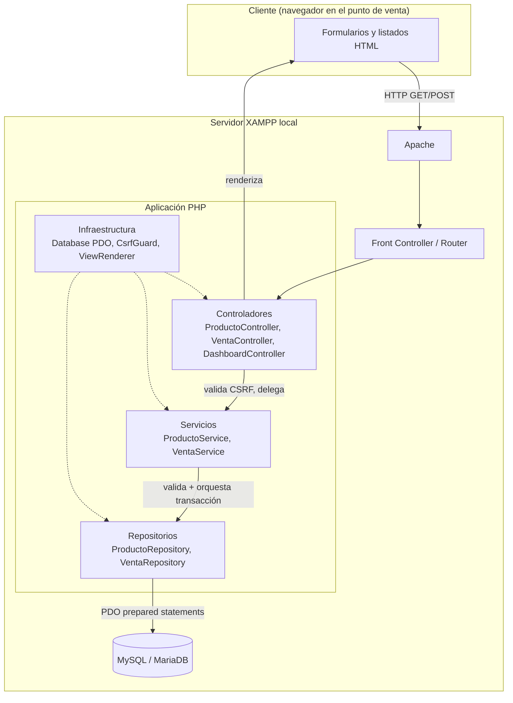
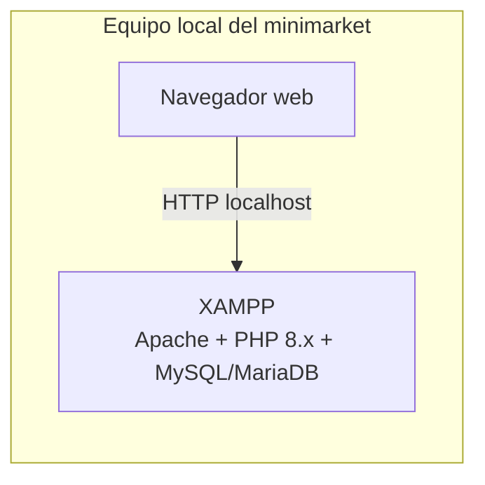
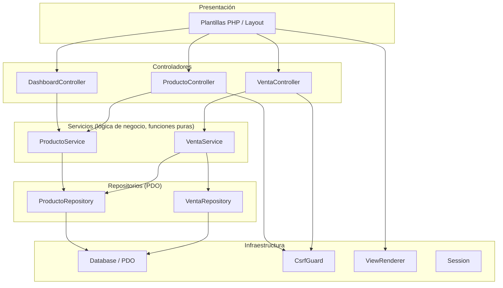
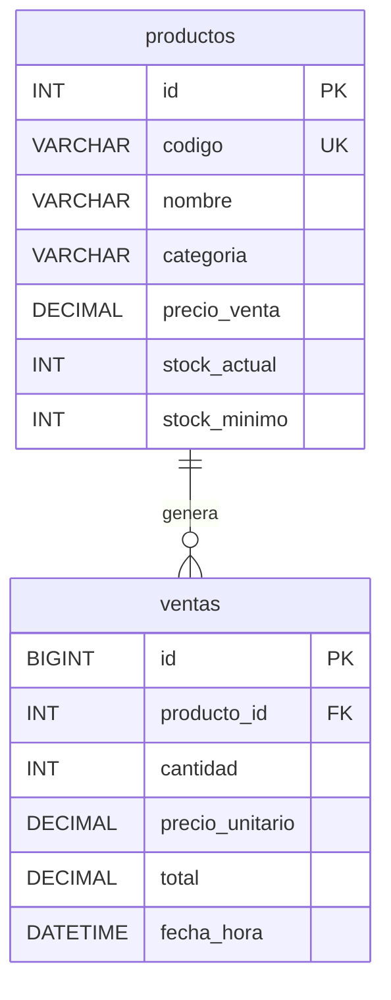
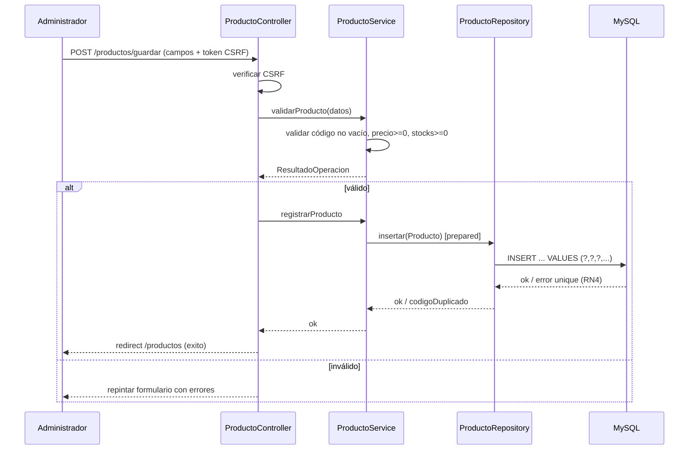
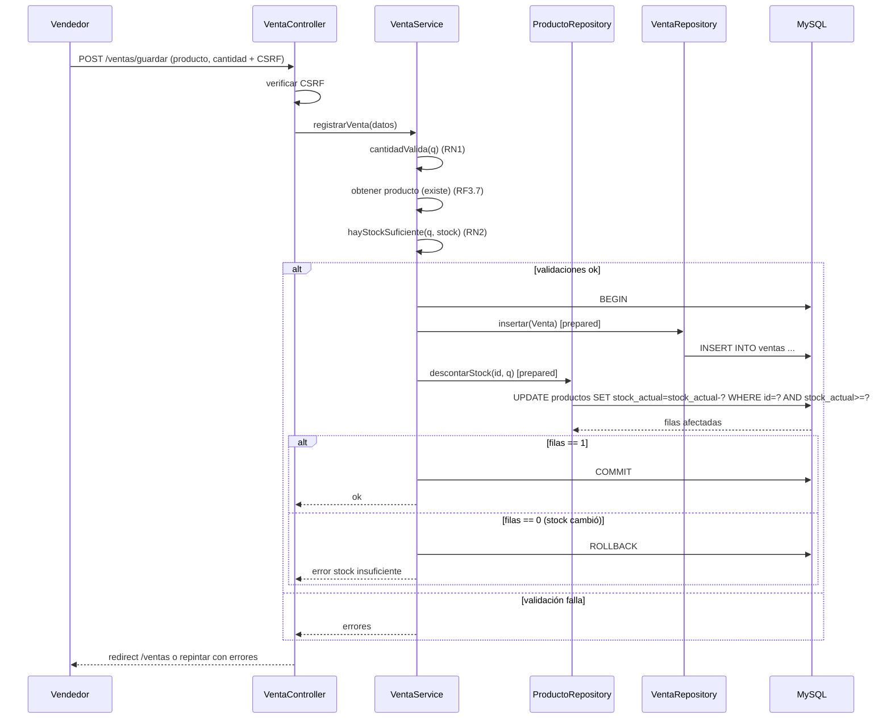
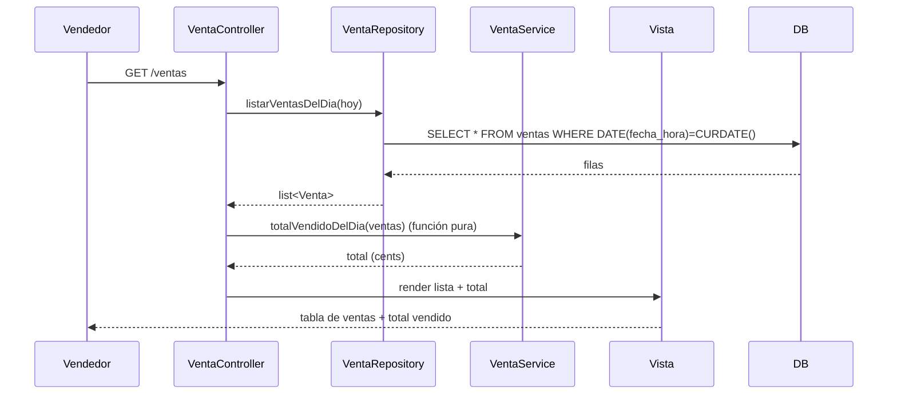

# Design Document — Sistema de Ventas e Inventario para el Minimarket "La Esquina"

**Espec:** `minimarket-ventas-inventario`
**Flujo de trabajo:** Requirements-First
**Fuente de requerimientos:** `requirements.md` (y `D0.md` como análisis de origen)
**Stack objetivo:** PHP 8.x + MySQL/MariaDB sobre XAMPP (uso local, sin autenticación)

---

## Overview

Este documento traduce los requerimientos funcionales (RF1–RF4) y no funcionales (RNF1–RNF4) del minimarket "La Esquina" en una arquitectura técnica concreta, ejecutable sobre el entorno XAMPP local. El sistema permite mantener un catálogo de productos, registrar ventas con descuento automático de stock, visualizar alertas de stock mínimo y consultar las ventas del día con su total vendido.

### Objetivos del diseño

1. **Cumplir los RF1–RF4** con flujos claros para registro de productos, listado con alertas, registro de ventas y consulta de ventas del día.
2. **Garantizar RNF1 (persistencia)** sobre MySQL/MariaDB y **RNF2 (integridad)** mediante constraints de base de datos y validación en el lado de la aplicación.
3. **Garantizar RNF3 (atomicidad)** de la venta y el descuento de stock mediante transacciones PDO.
4. **Garantizar RNF4 (seguridad)** mediante sentencias preparadas PDO (anti-inyección SQL), tokens anti-CSRF y escapado HTML (anti-XSS).

### Principios y restricciones de diseño

- **Aplicación monolítica ligera**, sin framework pesado, apropiada para uso local en el punto de venta. Se prefiere simplicidad y mantenibilidad sobre escalabilidad (SUPUESTO 5: ~500 productos y ~200 ventas/día).
- **Separación de capas** (Presentación / Controladores / Servicios / Repositorios) para mantener la lógica de negocio aislada y testeable, y para que los cambios de transporte (HTTP) o de presentación no afecten las reglas de negocio.
- **Sin autenticación ni roles** (fuera de alcance explícito). La seguridad cubierta se limita a inyección SQL, CSRF y XSS.
- **Dinero representado con precisión** (ver Decisión de diseño D1): `DECIMAL(10,2)` en base de datos y aritmética de enteros (centavos) en PHP para evitar errores de coma flotante.

### Decisiones de diseño destacadas

- **D1 — Representación del dinero:** los precios y totales se almacenan como `DECIMAL(10,2)` en MySQL y, en la lógica de negocio en PHP, se manipulan como enteros de centavos (`precio_cents = precio * 100`) usando operaciones enteras o `bcmath`. Esto evita el clásico error de precisión de coma flotante en sumas de ventas y hace que el cálculo del total sea determinista y propicio para property-based testing.
- **D2 — Patrón de arquitectura:** MVC ligero en capas (Controlador → Servicio → Repositorio → PDO) en lugar de un único `index.php` con SQL embebido. Aislar los servicios permite probar las reglas de negocio (RN1–RN5) como funciones puras sin tocar la base de datos.
- **D3 — Detección de stock insuficiente (RN2):** se valida con `SELECT ... FOR UPDATE` del producto dentro de la transacción y luego `UPDATE productos SET stock_actual = stock_actual - :cantidad WHERE id = :id AND stock_actual >= :cantidad`. La condición `stock_actual >= :cantidad` en el `UPDATE` evita condiciones de carrera entre vendedores concurrentes sin depender de bloqueos manuales adicionales.
- **D4 — Validación antes de persistir (RNF2.5):** toda validación de entrada (código no vacío, precio no negativo, cantidad entera > 0, stocks no negativos) se ejecuta en la capa de servicio **antes** de abrir la transacción, devolviendo mensajes comprensibles al usuario.
- **D5 — Resaltado de alertas (RF2.2):** la condición `stock_actual <= stock_minimo` se evalúa en la vista con un helper puro `debe_resaltar($stockActual, $stockMinimo)`, de modo que la regla sea testeable de forma aislada del HTML/CSS.

---

## Architecture

### Estilo arquitectónico

Arquitectura **monolítica en capas** (layered MVC) desplegada en un único servidor XAMPP local. El navegador del punto de venta realiza peticiones HTTP a Apache, que enruta a un front controller PHP. La aplicación se divide en cuatro capas:

1. **Presentación (Vistas):** plantillas PHP que renderizan HTML escapando toda salida dinámica. Sin lógica de negocio.
2. **Controladores:** reciben la petición HTTP, validan el token CSRF, delegan a los servicios y seleccionan la vista. Sin SQL directo.
3. **Servicios (Lógica de negocio):** implementan las reglas de negocio (RN1–RN5), validaciones y orquestación de transacciones. Contienen las funciones puras que serán objeto de property-based testing.
4. **Repositorios (Acceso a datos):** encapsulan todo el SQL mediante sentencias preparadas PDO. Únicos componentes que conocen la base de datos.

### Diagrama de capas



### Diagrama de despliegue



- El sistema se accede vía `http://localhost/ventas-bodega/...`. No se publica en internet (SUPUESTO 6, fuera de alcance).
- La disponibilidad depende del equipo local; no se requiere alta disponibilidad ni redundancia.

### Manejo de peticiones (resumen)

1. El navegador envía `GET` o `POST` a `index.php`.
2. El **Router** mapea la ruta (`/productos`, `/productos/guardar`, `/ventas`, `/ventas/guardar`, `/`) a un método de controlador.
3. Para `POST` que modifican datos, el controlador **valida el token anti-CSRF** antes de continuar (RNF4.2).
4. El controlador delega en el **servicio** correspondiente.
5. El servicio aplica validaciones (RNF2) y, para ventas, una **transacción atómica** (RNF3).
6. Los repositorios ejecutan **sentencias preparadas PDO** (RNF4.1).
7. El controlador selecciona la vista, que **escapa HTML** en toda salida dinámica (RNF4.3).

---

## Components and Interfaces

### Front Controller / Router

- **Responsabilidad:** punto de entrada único (`index.php`), parseo de ruta, despacho a controladores, manejo central de `PDOException`.
- **Interfaz:** `Router::dispatch(string $method, string $path): Response`.

### Controladores

| Componente | Responsabilidad | Métodos clave |
|-----------|-----------------|---------------|
| `DashboardController` | Página de inicio / menú principal. | `index()` |
| `ProductoController` | RF1 (registrar) y RF2 (listar). | `listar()`, `formularioCrear()`, `guardar(array $post)` |
| `VentaController` | RF3 (registrar venta) y RF4 (listar día). | `formularioRegistrar()`, `guardar(array $post)`, `listarDia()` |

- Los controladores **no** contienen SQL ni reglas de negocio. Leen `$_POST`/`$_GET`, validan CSRF, llaman a servicios y devuelven la vista.
- `guardar()` devuelve un resultado con `éxito`/`errores` que el controlador usa para redirigir o repintar el formulario con mensajes.

### Servicios (lógica de negocio)

| Componente | Responsabilidad | Funciones puras / métodos |
|-----------|-----------------|---------------------------|
| `ProductoService` | Validación de producto (RF1, RNF2). | `validarProducto(array $datos): array{valido: bool, errores: list, producto: ?Producto}`, `codigoExiste(string $codigo): bool` (delega al repo) |
| `VentaService` | Registro atómico de venta (RF3, RNF3). | `registrarVenta(array $datos): ResultadoVenta`, funciones puras: `calcularTotal($precioCents, $cantidad)`, `cantidadValida($q)`, `precioValido($p)`, `hayStockSuficiente($cantidad, $stockActual)`, `debeResaltar($stockActual, $stockMinimo)` |

- `registrarVenta()` abre `beginTransaction()`, ejecuta inserción de venta + descuento de stock, y hace `commit()` o `rollBack()` según corresponda (RNF3.1–RNF3.3).
- Las funciones puras de validación y cálculo **no** dependen de PDO: son las candidatas a property-based testing.

### Repositorios (acceso a datos)

| Componente | Responsabilidad | Métodos clave (PDO prepared) |
|-----------|-----------------|-------------------------------|
| `ProductoRepository` | CRUD de productos. | `insertar(Producto $p)`, `obtenerPorCodigo(string $codigo)`, `obtenerPorId(int $id)`, `listarTodos(): list<Producto>`, `descontarStock(int $id, int $cantidad): int` (filas afectadas) |
| `VentaRepository` | Inserción y consulta de ventas. | `insertar(Venta $v)`, `listarVentasDelDia(DateTime $hoy): list<Venta>`, `totalVendidoDelDia(DateTime $hoy): int (cents)` |

- `descontarStock()` usa `UPDATE ... SET stock_actual = stock_actual - :cantidad WHERE id = :id AND stock_actual >= :cantidad` (D3). Devuelve filas afectadas: 0 ⇒ stock insuficiente (RN2).
- `listarVentasDelDia()` filtra por `DATE(fecha_hora) = CURDATE()` o por rango `[hoy 00:00:00, hoy 23:59:59]`.

### Infraestructura

| Componente | Responsabilidad |
|-----------|----------------|
| `Database` | Conexión PDO singleton (`PDO::ATTR_ERRMODE => ERRMODE_EXCEPTION`, `ATTR_EMULATE_PREPARES => false`). |
| `CsrfGuard` | Genera/almacena token en sesión (`$_SESSION`) y lo valida en POST (RNF4.2). Métodos: `token(): string`, `verificar(string $token): bool`. |
| `Session` | Inicio seguro de sesión (`httponly`, `samesite`). |
| `ViewRenderer` | Renderiza plantillas PHP exponiendo un helper `e($v)` = `htmlspecialchars($v, ENT_QUOTES, 'UTF-8')` (RNF4.3). |

### Diagrama de componentes



---

## Data Models

### Esquema de base de datos

#### Tabla `productos`

| Columna | Tipo | Restricciones | Notas |
|---------|------|---------------|-------|
| `id` | `INT UNSIGNED` | `PRIMARY KEY AUTO_INCREMENT` | Surrogate key. |
| `codigo` | `VARCHAR(64)` | `NOT NULL UNIQUE` | RN4: unicidad del código. |
| `nombre` | `VARCHAR(150)` | `NOT NULL` | |
| `categoria` | `VARCHAR(80)` | `NULL` | Puede quedar vacío. |
| `precio_venta` | `DECIMAL(10,2)` | `NOT NULL DEFAULT 0.00` | RN3: no negativo (validado en app). `CHECK (precio_venta >= 0)` si el motor lo soporta. |
| `stock_actual` | `INT UNSIGNED` | `NOT NULL DEFAULT 0` | No negativo (RNF2.3). |
| `stock_minimo` | `INT UNSIGNED` | `NOT NULL DEFAULT 0` | No negativo (RNF2.3). |

- Índices: `UNIQUE (codigo)`. Índice secundario en `(stock_actual, stock_minimo)` para acelerar el listado con alertas (opcional, dada la baja cardinalidad).

#### Tabla `ventas`

| Columna | Tipo | Restricciones | Notas |
|---------|------|---------------|-------|
| `id` | `BIGINT UNSIGNED` | `PRIMARY KEY AUTO_INCREMENT` | |
| `producto_id` | `INT UNSIGNED` | `NOT NULL FOREIGN KEY → productos(id)` | RNF2.2: integridad referencial. |
| `cantidad` | `INT UNSIGNED` | `NOT NULL` | RN1: entero > 0 (validado en app). |
| `precio_unitario` | `DECIMAL(10,2)` | `NOT NULL` | Precio vigente al momento de la venta. |
| `total` | `DECIMAL(10,2)` | `NOT NULL` | `precio_unitario * cantidad`. |
| `fecha_hora` | `DATETIME` | `NOT NULL DEFAULT CURRENT_TIMESTAMP` | RF3.3. |

- Índices: `INDEX (producto_id)`, `INDEX (fecha_hora)` (para el listado del día RF4).

#### Diagrama entidad-relación



### Constraints que materializan las reglas de negocio

| Regla | Mecanismo en BD | Refuerzo en aplicación |
|-------|----------------|-------------------------|
| RN4 (código único) | `UNIQUE (codigo)` | `ProductoService::validarProducto` + `codigoExiste()` |
| RN2 (no vender más que stock) | `UPDATE ... WHERE stock_actual >= :cantidad` | `VentaService::hayStockSuficiente()` |
| RNF2.2 (integridad referencial) | `FOREIGN KEY (producto_id) → productos(id)` | Validación previa de existencia del producto |
| RNF2.3 (stocks no negativos) | `INT UNSIGNED` | Validación de enteros no negativos en `ProductoService` |
| RN1 (cantidad > 0) | `INT UNSIGNED` | `VentaService::cantidadValida()` |
| RN3 (precio no negativo) | `DECIMAL` + validación | `ProductoService::validarProducto` |
| RN5 (atomicidad) | Transacción PDO (`beginTransaction`/`commit`/`rollBack`) | `VentaService::registrarVenta()` |

### Modelo de dominio (PHP)

- `Producto` (DTO/entidad): `$id, $codigo, $nombre, $categoria, $precioVentaCents, $stockActual, $stockMinimo`.
- `Venta` (DTO): `$id, $productoId, $cantidad, $precioUnitarioCents, $totalCents, $fechaHora`.
- `ResultadoOperacion`: `{$valido: bool, $errores: list<string>, $datos: array}` — valor de retorno estándar de los servicios para que los controladores repinten formularios con mensajes.

### Flujos de datos por requerimiento funcional

#### RF1 — Registrar producto



#### RF2 — Listar productos con alertas

```mermaid
sequenceDiagram
    participant U as Administrador
    participant C as ProductoController
    participant R as ProductoRepository
    participant V as Vista
    U->>C: GET /productos
    C->>R: listarTodos()
    R->>DB: SELECT * FROM productos
    DB-->>R: filas
    R-->>C: list<Producto>
    C->>V: render con helper debe_resaltar()
    V-->>U: tabla HTML; filas con stock_actual <= stock_minimo resaltadas
```

#### RF3 — Registrar venta (atómica)



#### RF4 — Listar ventas del día y total



---

## Correctness Properties

*A property is a characteristic or behavior that should hold true across all valid executions of a system — essentially, a formal statement about what the system should do. Properties serve as the bridge between human-readable specifications and machine-verifiable correctness guarantees.*

### Ámbito de aplicación de Property-Based Testing

Este sistema mezcla tres clases de comportamiento:

- **Lógica de negocio pura** (cálculo del total, validaciones, condición de alerta, suma del día): funciones puras con entrada/salida clara, que varían con la entrada y son baratas de ejecutar 100+ veces. **Aptas para PBT** → se definen aquí.
- **Acceso a datos y transacciones** (persistencia, unicidad por constraint, atomicidad, FK): dependen de la BD real y no varían de forma que justifique PBT. Se cubren con **tests de integración** (1–3 ejemplos).
- **UI y seguridad de formulario** (render, resaltado visual, CSRF, escapado XSS): se cubren con **tests de ejemplo / smoke**.

La aritmética de dinero se realiza en **centavos enteros** (Decisión D1), lo que hace que las propiedades de cálculo y suma sean deterministas (sin drift de coma flotante) y por tanto verificables por PBT.

### Property 1: Cálculo del total de la venta con precisión de centavos

**Validates: Requirements 3.2**

*Para cualquier* precio de venta (expresado en centavos, entero no negativo) y *para cualquier* cantidad vendida (entero mayor que cero), el total de la venta será igual a `precio_cents * cantidad`, será un entero no negativo y no presentará error de precisión.

### Property 2: Validación de precio de venta no negativo y numérico

**Validates: Requirements 1.3, 6.5**

*Para cualquier* valor de entrada, la validación de precio rechazará los valores no numéricos y los negativos, y aceptará el cero y los valores positivos.

### Property 3: Validación de código de producto no vacío

**Validates: Requirements 1.4, 6.5**

*Para cualquier* cadena de texto, la validación de código rechazará las cadenas vacías y las compuestas únicamente por espacios en blanco, y aceptará las cadenas con contenido visible.

### Property 4: Validación de cantidad vendida entera mayor que cero

**Validates: Requirements 3.5, 6.4**

*Para cualquier* valor de entrada, la validación de cantidad rechazará el cero, los negativos, los no enteros y los no numéricos, y aceptará los enteros estrictamente positivos.

### Property 5: Validación de stocks no negativos y enteros

**Validates: Requirements 6.3**

*Para cualquier* valor de entrada, la validación de `stock_actual` y de `stock_minimo` rechazará los negativos y los no enteros, y aceptará el cero y los enteros positivos.

### Property 6: Condición de alerta de stock mínimo

**Validates: Requirements 2.2**

*Para cualquier* par de enteros no negativos `(stock_actual, stock_minimo)`, la condición de alerta se cumplirá si y solo si `stock_actual <= stock_minimo`.

### Property 7: Venta válida preserva stock no negativo

**Validates: Requirements 3.4, 3.6**

*Para cualquier* producto con `stock_actual` no negativo y *para cualquier* cantidad entera mayor que cero: si la cantidad es menor o igual al stock, la venta es válida y el nuevo stock resulta `stock_actual - cantidad` (un valor no negativo); si la cantidad supera el stock, la venta se rechaza.

### Property 8: Total vendido del día es la suma de los totales y es independiente del orden

**Validates: Requirements 4.2**

*Para cualquier* lista de ventas del día, el total vendido será igual a la suma de los totales individuales; para la lista vacía el total será cero; y el total será el mismo sin importar el orden en que se sumen las ventas (conmutatividad/asociatividad, garantizada por el uso de centavos enteros).

---

## Error Handling

La estrategia centraliza el manejo de errores para entregar siempre **mensajes comprensibles** (RNF de usabilidad) y evitar estados inconsistentes (RNF2, RNF3).

### Categorías de error y tratamiento

| Categoría | Origen | Tratamiento |
|-----------|--------|-------------|
| Validación de entrada (RF1.3, RF1.4, RF3.5, RNF2.3) | Capa de servicio | `ResultadoOperacion{valido:false, errores:[...]}`. El controlador repinta el formulario conservando los datos válidos y mostrando los mensajes. **No se abre transacción ni se persiste nada** (RNF2.5). |
| Código duplicado (RN4, RF1.2) | Validación previa + constraint `UNIQUE` | Se detecta primero con `codigoExiste()` (mensaje claro "El código ya existe"). Si una carrera lo evita, el `PDOException` de `SQLSTATE 23000` se captura y se traduce al mismo mensaje. |
| Stock insuficiente (RN2, RF3.6) | `descontarStock()` devuelve 0 filas | Se hace `ROLLBACK` (RNF3.2) y se devuelve "Stock insuficiente" indicando el stock disponible. |
| Producto inexistente (RF3.7, RNF2.2) | Validación previa / FK | Mensaje "El producto no está registrado". |
| Fallo de BD en inserción/actualización | `PDOException` | `ROLLBACK` (RNF3.2, RNF3.3), log interno y mensaje genérico "No se pudo completar la operación". |
| Token CSRF inválido/ausente (RNF4.2) | `CsrfGuard::verificar()` | Se rechaza con 422 "Petición no válida"; no se procesa el POST. |
| Error no controlado | Front controller | Captura de `Throwable`, mensaje genérico al usuario y log. Nunca se exponen detalles de BD al usuario. |

### Atomicidad y rollback (RN5)

`VentaService::registrarVenta()` envuelve inserción de venta + descuento de stock en una transacción PDO:

```
try {
    $pdo->beginTransaction();
    $ventaId = $ventaRepo->insertar($venta);
    $afectadas = $productoRepo->descontarStock($productoId, $cantidad);
    if ($afectadas !== 1) { throw new StockInsuficienteException(); }
    $pdo->commit();
} catch (Throwable $e) {
    $pdo->rollBack();
    // traducir a ResultadoOperacion con mensaje comprensible
}
```

- Garantiza RNF3.1 (ambas operaciones juntas), RNF3.2 (si el descuento falla, la venta no se registra) y RNF3.3 (si la venta falla, el stock no se descuenta).
- Las validaciones que no requieren BD (RN1, RN3, RNF2.3, RF1.4) se ejecutan **antes** de `beginTransaction()` para no desperdiciar transacciones y para cumplir "rechazar antes de persistir" (RNF2.5).

### Trazabilidad de errores a requerimientos

- Mensajes comprensibles: RF1.4, usabilidad.
- Rechazo antes de persistir: RNF2.5.
- Rollback simétrico: RNF3.2, RNF3.3.
- No exposición de detalles técnicos: RNF4 (seguridad).

---

## Testing Strategy

### Enfoque dual (unit + property) complementado con integración y smoke

| Nivel | Cubre | Herramienta |
|-------|-------|-------------|
| **Property-based tests** | Funciones puras de negocio (Propiedades 1–8) | PHPUnit + librería PBT |
| **Unit tests** | Ejemplos concretos, casos borde, integración entre componentes | PHPUnit |
| **Integration tests** | Persistencia, unicidad (UNIQUE), FK, atomicidad/rollback, listados del día | PHPUnit + BD de prueba (SQLite in-memory para lógica compatible o MySQL/MariaDB de prueba) |
| **Smoke tests** | Configuración de PDO, sentencias preparadas, arranque de la app | PHPUnit |
| **Ejemplo/E2E** | CSRF, escapado XSS, render de alertas | PHPUnit + (opcional) pruebas de cliente HTTP |

### Property-Based Testing

- **Runner:** PHPUnit (estándar de PHP).
- **Librería PBT:** se elige una librería QuickCheck-style para PHP (p. ej. `funkphp/funk` o equivalente mantenida) para la generación de entradas aleatorias. La elección final de la librería se confirma en la fase de implementación; las propiedades definidas son independientes de la librería. Si no se desea dependencia externa, se usan **data providers de PHPUnit** con un generador aleatorio sembrado, sin reimprimir un motor PBT desde cero.
- **Configuración obligatoria:** cada propiedad ejecuta **mínimo 100 iteraciones** (por la aleatoriedad).
- **Etiquetado:** cada test de propiedad incluye un comentario con el formato `Feature: minimarket-ventas-inventario, Property {n}: {texto de la propiedad}`.
- **Implementación:** cada propiedad se implementa como **un único** test property-based que referencia la propiedad del diseño. El dinero se modela en centavos enteros para que las propiedades de cálculo y suma sean deterministas.

### Mapeo de propiedades a tests PBT

| Propiedad | Función bajo prueba | Refs |
|----------|--------------------|------|
| 1 | `VentaService::calcularTotal($precioCents, $cantidad)` | RF3.2 |
| 2 | `ProductoService::precioValido($p)` | RF1.3, RNF2.5 |
| 3 | `ProductoService::codigoValido($codigo)` | RF1.4, RNF2.5 |
| 4 | `VentaService::cantidadValida($q)` | RF3.5, RNF2.4 |
| 5 | `ProductoService::stockValido($s)` | RNF2.3 |
| 6 | `VentaService::debeResaltar($stockActual, $stockMinimo)` | RF2.2 |
| 7 | `VentaService::hayStockSuficiente` + deducción | RF3.4, RF3.6 |
| 8 | `VentaService::totalVendido(array $ventas)` | RF4.2 |

### Tests de integración (no aptos para PBT)

- **RF1.1 / RNF1.1:** insertar producto y verificar round-trip de todos los campos.
- **RF1.2 / RNF2.1 (RN4):** intentar duplicar código y verificar rechazo por validación + `UNIQUE`.
- **RF3.3:** registrar venta y verificar persistencia con `fecha_hora` válida.
- **RF3.7 / RNF2.2:** venta de `producto_id` inexistente se rechaza (FK/validación).
- **RF4.1:** listar ventas del día: insertar ventas de hoy y de otro día, verificar que solo aparecen las de hoy.
- **RNF3.1:** venta válida ⇒ venta + descuento se aplican juntos (commit).
- **RNF3.2:** fallo en el descuento ⇒ la venta no queda registrada (rollback).
- **RNF3.3:** fallo en el insert de venta ⇒ el stock no se descuenta (rollback).
- **RNF1.2:** tras (simular) reinicio de conexión, los datos persisten.

### Tests smoke (no aptos para PBT)

- **RNF4.1:** verificar que los repositorios usan `prepare()`+`execute()` con parámetros (inspección de código o ejecución con un query logger que confirme parámetros enlazados).
- Arranque de la app: `index.php` responde 200 y la conexión PDO se establece con `ERRMODE_EXCEPTION`.

### Tests de ejemplo / UI

- **RF2.1:** el listado muestra todos los productos con todos sus campos.
- **RF3.1:** el formulario permite seleccionar producto por código/nombre y tiene campo de cantidad.
- **RNF4.2 (CSRF):** POST sin token o con token inválido ⇒ 422; con token válido ⇒ procesado.
- **RNF4.3 (XSS):** render de un producto con nombre `<script>alert(1)</script>` produce `&lt;script&gt;...` en la salida (no se inyecta el script).
- **RF2.2 (resaltado):** una fila con `stock_actual <= stock_minimo` recibe la clase CSS de alerta.

### Balance y cobertura

- Los tests de propiedad cubren **toda la lógica de negocio pura** (RN1, RN2, RN3, cálculos y agregaciones) con alta cobertura de entrada.
- Los tests de integración cubren **persistencia, integridad y atomicidad** (RNF1, RNF2, RNF3) con 1–3 ejemplos representativos.
- Los tests smoke/ejemplo cubren **seguridad y UI** (RNF4, RF2.2 visual).
- Los tests unitarios se reservan para ejemplos concretos, casos borde de las funciones puras y puntos de integración entre componentes, evitando duplicar lo que el PBT ya cubre.

### Cobertura de reglas de negocio

| Regla | Cobertura principal |
|-------|---------------------|
| RN1 (cantidad > 0) | Propiedad 4 (PBT) + integración |
| RN2 (no vender más que stock) | Propiedad 7 (PBT) + integración (rollback) |
| RN3 (precio no negativo) | Propiedad 2 (PBT) + integración |
| RN4 (código único) | Integración (UNIQUE) + validación |
| RN5 (atomicidad) | Integración (transacción/rollback) |
